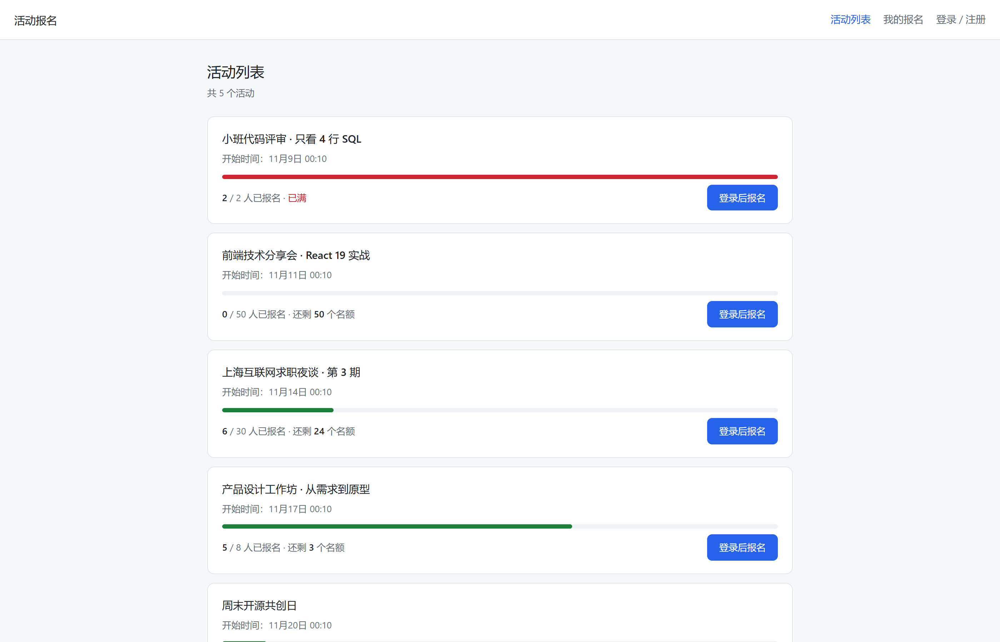
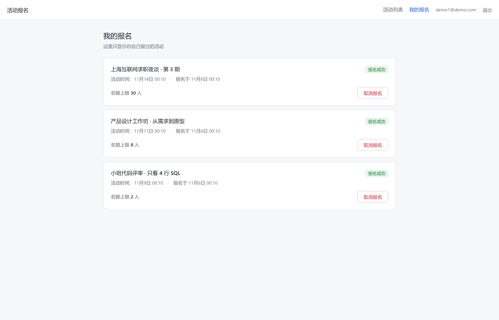
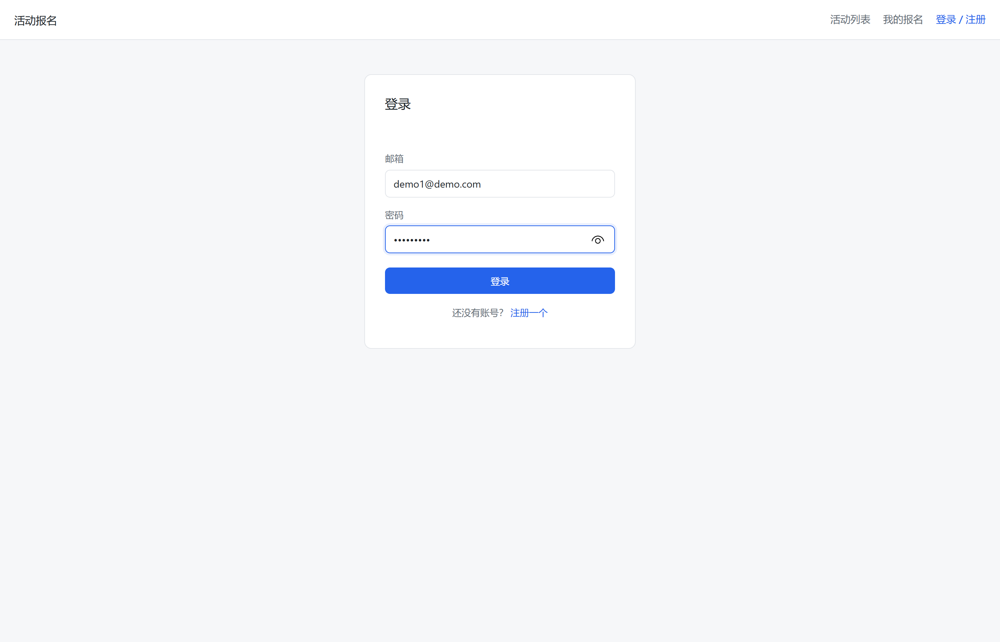

# 活动报名系统

一个活动报名与名额管理系统：发布活动、限制名额、报名、取消、查看我的报名。
重点解决 **高并发下的名额超卖** 问题，并完整部署到公网。

**在线演示：<http://47.111.223.71:8081>** ｜ **源码：<https://github.com/Lijjj656/signup-system>**

| 角色 | 账号 | 密码 |
|---|---|---|
| 普通用户 | `demo1@demo.com` | `demo12345` |

> 演示数据包含 5 个活动，分别覆盖「无人报名 / 正常 / 接近满 / 已满」四种状态。
>
> **管理员账号不公开**：`POST /api/events`（创建活动）有 `role = admin` 校验，若在公开仓库里给出管理员明文密码，任何人都能往演示站点灌数据。故该账号密码只在部署时单独设置，不写入代码与文档。

---

## 界面

<p align="center">
  
  
</p>

左边是活动列表：每个活动带一条进度条和「已报名 / 名额上限 / 剩余名额」，
其中「小班代码评审」已经 2/2 报满，入口自动置灰；右边登录后只显示自己的报名记录，可取消。

<p align="center">
  
</p>

---

## 为什么做这个

校园和社群里最常见的报名方式是「微信群接龙」或共享表格，会稳定出现四个问题：

1. **名额超卖** —— 两个人同时看到「还剩 1 个位子」，最后来了两个人
2. **身份不可核验** —— 谁都能替别人填，取消只是一句话，最终名单没人说得准
3. **重复报名** —— 同一个人换个名字格式填两次
4. **状态不可查** —— 「我到底报上没有」只能翻聊天记录

这个项目就是把上面四件事用数据库约束和事务管住。

---

## 技术栈

| 层 | 选型 | 说明 |
|---|---|---|
| 运行时 | Node.js 20 | |
| Web 框架 | Express 5 | 单体应用，四层结构：`app → routes → pg 连接池 → PostgreSQL` |
| 数据库 | PostgreSQL 14/15 | 用它的**事务与行锁**做名额控制，这是本项目核心 |
| 鉴权 | JWT + bcryptjs | 密码只存 bcrypt 哈希，`$2b$10$...`，不可逆 |
| 前端 | 原生 HTML / CSS / JS | 3 个页面 + 1 个统一的 fetch 封装，无构建步骤 |
| 进程守护 | systemd + pm2-runtime | 专用系统用户 `signup` 运行，开机自启，进程退出自动重启 |
| 反向代理 | nginx | 8081 → 3000，与同机另一项目（占 80）按端口隔离 |

**为什么不用框架/ORM**：项目只有 3 张表 9 个接口，ORM 带来的抽象收益低于它遮蔽掉的细节成本。
名额控制恰恰依赖手写 SQL 的 `SELECT ... FOR UPDATE`，用 ORM 反而要绕出去写原生查询。

---

## 架构

```
浏览器（原生 JS + fetch + JWT）
        │  HTTP :8081
        ▼
   nginx（反向代理，透传 X-Real-IP / X-Forwarded-For）
        │  HTTP :3000
        ▼
   Node.js + Express（REST API + express.static 托管前端）
        │  pg 连接池
        ▼
   PostgreSQL :5432（3 张表）
```

---

## 核心设计

### 一、并发名额控制（本项目重点）

**问题**：`quota = 1` 的活动，20 个并发请求打进来，数据库里写进了 **20 条** `confirmed` 记录。

**定位过程**（这一步比结论更重要）：

- 首轮用 10 并发压测，**结果正常**，差点得出「没有问题」的错误结论
- 怀疑并发窗口没真正形成：连接池在首次请求时才建立 TCP 连接，**建连耗时把请求自然错开了**
- 改为「先预热建连、再瞬间打并发」，20 并发立刻复现
- 定位到接口里是「先 `SELECT count(*)` 判余量、再 `INSERT`」两条独立语句，中间存在时间窗 ——
  经典的 **TOCTOU（Time-of-check to time-of-use）**

**方案**：把校验和写入收敛进同一事务的临界区，用行锁串行化：

```sql
BEGIN;
SELECT id, quota FROM events WHERE id = $1 FOR UPDATE;   -- 锁住这一行
SELECT count(*)::int FROM registrations
  WHERE event_id = $1 AND status = 'confirmed';          -- 在锁内数
-- 余量 > 0 → INSERT；否则 ROLLBACK 并返回 409
COMMIT;
```

`FOR UPDATE` 让第二个事务**阻塞在这一行上**，等前一个提交后才继续，此时它数到的余量已经是 0。

**效果**：同一脚本同一参数重测，**50 并发 / 1 个名额，只有 1 人成功，其余 49 个返回 409**。

> `UNIQUE(user_id, event_id)` 是补充而不是替代：唯一约束管的是「同一人同一活动」，
> 管不了「不同人抢同一名额」。

### 二、取消与重新报名：状态机 + 唯一约束

`UNIQUE(user_id, event_id)` 保证了同一人不会重复报名，但也让「先取消、再报名」撞上唯一冲突（23505）。

三条路的取舍：

| 方案 | 代价 |
|---|---|
| 取消时 DELETE | 丢失审计痕迹，且「取消是否释放名额」会和删除行为纠缠 |
| 去掉唯一约束 | 同一人出现多行，每次查询要 group，容易算错名额 |
| **保留唯一行 + status 状态机** | 报名逻辑要改成「存在则 UPDATE，不存在则 INSERT」 |

选第三条：`cancelled → confirmed → cancelled`，一行永远只有一行。
重新报名时若查到该行为 `cancelled`，在**同一把行锁内**重新校验余量后 UPDATE 回 `confirmed`。

### 三、鉴权与错误信息

- 密码 bcrypt（cost 10）哈希后入库，**没有任何地方存明文或可逆加密**
- JWT 只做签名不做加密，payload 里只有 `id` / `email` / `role`，不放敏感信息
- **登录失败统一文案**：邮箱不存在和密码错误返回同一句话，避免邮箱枚举
- `app.disable('x-powered-by')` 少暴露一点技术栈
- 前端：`escapeHtml` 防 XSS；`safeNext` 校验跳转目标防开放重定向；401 自动清 token 回登录页

---

## 数据模型

| 表 | 关键字段 | 约束 |
|---|---|---|
| `users` | `id`、`email`、`password_hash`、`role` | `email` UNIQUE |
| `events` | `id`、`title`、`quota`、`start_at`、`created_by` | `created_by` → `users.id` |
| `registrations` | `id`、`user_id`、`event_id`、`status` | `UNIQUE(user_id, event_id)`；`user_id`/`event_id` 外键 |

`events` **不存「已用名额」字段**：需求数由 `registrations` 实时统计，避免两处状态不一致。
代价是每次查询多一次 `count`，量大了应改为预扣库存 + 异步对账。

---

## 接口

| 方法 | 路径 | 说明 | 鉴权 |
|---|---|---|---|
| POST | `/api/auth/register` | 注册（密码至少 8 位） | — |
| POST | `/api/auth/login` | 登录，返回 JWT | — |
| GET | `/api/auth/me` | 当前用户 | ✅ |
| GET | `/api/events` | 活动列表（带已报名数与余量） | — |
| GET | `/api/events/:id` | 活动详情 | — |
| POST | `/api/events` | 创建活动 | ✅ 管理员 |
| POST | `/api/events/:id/register` | 报名（事务 + 行锁） | ✅ |
| POST | `/api/events/:id/cancel` | 取消（UPDATE 状态，非删除） | ✅ |
| GET | `/api/my/registrations` | 我的报名 | ✅ |
| GET | `/api/health` | 健康检查（含数据库连通性） | — |

---

## 本地运行

```bash
# 1. 依赖
npm install

# 2. 配置
cp .env.example .env      # 然后改里面的 DATABASE_URL 与 JWT_SECRET

# 3. 建表 + 演示数据
psql -h 127.0.0.1 -U postgres -d signup -f db/schema.sql
psql -h 127.0.0.1 -U postgres -d signup -f db/seed.sql

# 4. 启动
npm run dev               # node --watch
```

浏览器打开 <http://localhost:3000>。

## 测试

```bash
node test-api.js          # 23 项接口断言（只断状态码，不断文案）
node race-test.js 50      # 并发压测：50 个请求抢 1 个名额，预期只有 1 个成功
```

`race-test.js` 会先建连预热再打并发 —— 不预热的话请求会被建连耗时错开，**压不出并发问题**。

---

## 部署

Ubuntu 22.04 + Node 20（NodeSource）+ PostgreSQL 14 + pm2 + nginx。

**运行形态**：代码放 `/var/www/signup`，以专用系统用户 `signup` 运行（不碰 root）；
由 systemd 单元 `pm2-signup.service` 托管，进程管理模式用 `pm2-runtime`（前台常驻）。

```bash
# 1. 目录与归属
sudo mkdir -p /var/www/signup
sudo rsync -a --exclude node_modules ./ /var/www/signup/
sudo chown -R signup:signup /var/www/signup
sudo -u signup -H sh -c 'cd /var/www/signup && npm ci --omit=dev'

# 2. systemd 单元
sudo tee /etc/systemd/system/pm2-signup.service > /dev/null <<'EOF'
[Unit]
Description=signup: 活动报名系统 (Node.js via pm2-runtime)
After=network.target postgresql.service

[Service]
Type=simple
User=signup
Group=signup
WorkingDirectory=/var/www/signup
Environment=PM2_HOME=/home/signup/.pm2
Environment=NODE_ENV=production
ExecStart=/usr/bin/pm2-runtime start /var/www/signup/src/app.js --name signup
KillMode=mixed
KillSignal=SIGINT
TimeoutStopSec=15
Restart=always
RestartSec=3

[Install]
WantedBy=multi-user.target
EOF

sudo systemctl daemon-reload
sudo systemctl enable --now pm2-signup

# 3. 反向代理：sites-available/signup → sites-enabled
#    同机 80 端口已被另一个项目占用，故本项目监听 8081，
#    由 nginx 转发到 127.0.0.1:3000；两条 server 块按端口共存，互不冲突
nginx -t && systemctl reload nginx

# 4. 云服务器安全组必须显式放行 8081（见下）
```

**为什么不用 `pm2 start` + `pm2 save` 做开机自启**：

`pm2 startup` 生成的 unit 是 `Type=forking` + `PIDFile=$PM2_HOME/pm2.pid`，
但 PM2 7.x 已经不写这个 pid 文件（`.pm2/` 下只有 `pids/`、`pub.sock`、`rpc.sock`），
systemd 等不到就判 `protocol` 失败，重试 5 次后熔断成 `failed`。
三个方案实测：

| 方案 | 结果 |
|---|---|
| `Type=forking` + `PIDFile`（pm2 自带） | ❌ 永远 `failed: protocol` |
| `Type=oneshot` + `RemainAfterExit=yes` | ❌ **假 active**：`resurrect` 返回 0 但进程没起来 |
| **`Type=simple` + `pm2-runtime`** | ✅ 状态与真实进程一致，进程死则服务死 |

`Type=oneshot` 那条最坑：它只看退出码，`systemctl is-active` 返回 `active`，
而 `ss -lntp` 里 3000 端口根本没监听、`ps` 里也没有进程。
**判断服务是否真活着，只能看端口和健康检查，不能看 systemd 状态。**

另外两条实测细节：
- `pm2 kill` 在 systemd 的 `ExecStop` 里会拒绝执行，日志是
  `daemon not started by this service, leaving it running` —— 它只杀自己启动的 daemon。
  `pm2-runtime` 模式不存在这个问题（systemd 直接持有主进程）。
- 用 `sudo -u <user> pm2 start` 启动时，PM2 会把整个 sudo 环境（`SUDO_UID`、`SUDO_COMMAND`、`OLDPWD`）
  写进 `dump.pm2`。这种 dump 在 systemd 的干净环境里恢复并不可靠。

**一条踩过的坑**：云服务器安全组里有一条「全部(-1/-1) 允许」的默认规则，
实测**并不生效** —— 只有显式声明端口的规则才通。判断依据是端口响应的差异：

| 现象 | 含义 |
|---|---|
| `timeout`（超时） | 数据包在半路被丢弃，根本没到程序 |
| `Connection refused`（连接被拒） | 数据包到了机器，只是该端口没有程序监听 |

有显式规则的端口（22、3389）能通或返回「拒绝」，只被「全部」规则覆盖的端口（80/443/3000）全部超时
→ 结论：那条规则没生效，需要给每个端口补显式规则。

本项目迁到 8081 后又复核了一次同样的规律：未加规则时外网 `curl` 连接超时（`exit=28`），
显式添加 `8081/8081` 规则后立即返回 `200`，服务器侧未做任何改动。
顺带说明：`timeout` 与 `Connection refused` 的区分，是当时判断「包被丢在半路」还是「端口没人监听」的唯一依据。

---

## 已知限制

- **JWT 无法主动失效**：签发后只能等过期，没有黑名单/白名单存储（要做需引入 Redis）
- **行锁会把同一活动的并发串行化**：热点活动会成为瓶颈，量大时应改为预扣库存 + 队列
- **没有 CI、没有单元测试框架**：只有自写的断言脚本与压测脚本，不是 jest/vitest
- **没有监控告警**：线上排查看 `pm2 logs signup` 和 `nginx` 的 `error_log`
- 前端未做响应式适配测试，未做无障碍
